  

  
  
  

### Featured Projects

| Project | What It Does | Tech Stack |
| :--- | :--- | :--- |
| [**ForgeFolio**](https://github.com/BorceKhen/My-Personal-Works/tree/main/ForgeFolio) | 100% offline 4-way PDF ↔ Image ↔ DOCX document converter with a Candlelit Library Bookcase UI | Kotlin · Jetpack Compose · PDFBox · Apache POI |
| [**DeckCast Studio**](https://github.com/BorceKhen/My-Personal-Works/tree/main/DeckCast) | Offline LAN multi-device screen streaming & remote control between Windows and Android | Kotlin · WebRTC · Python · PyQt6 |
| [**FloatPaint (AERO-BRUSH)**](https://github.com/BorceKhen/My-Personal-Works/tree/main/FloatPaint) | Real-time 2D/3D hand-gesture air painting studio with MediaPipe & Three.js | Python · MediaPipe · Three.js |
| [**Image Compressor**](https://github.com/BorceKhen/My-Personal-Works/tree/main/Image%20Compressor) | Native C++ NDK (`libjpeg-turbo`) mobile image compression studio | Kotlin · Jetpack Compose · C++ NDK |
| [**ALALAY-AI**](https://github.com/BorceKhen/ALALAY-AI) | Adaptive learning web platform designed for visual impairments | HTML · CSS · Accessibility |
| [**Cookie-OS**](https://github.com/shian0604/Cookie-OS) | Collaborative Operating Systems final project exploring OS concepts | JavaScript · CSS |

### Core Stack

  
  
  
  
  
  
  
  

### GitHub Snapshot

  
  

